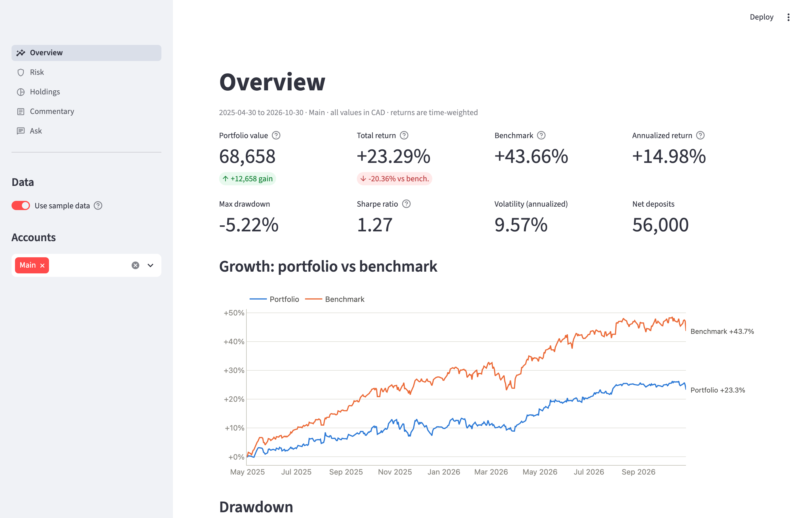

# Portfolio Analytics & Commentary

A Streamlit app that turns a broker's trade export into the reports a fund manager
would produce: time-weighted performance against a blended benchmark, risk
statistics, a check of position-sizing discipline, and an AI-written monthly
investor letter.

**The core rule: every number is calculated in Python.** The AI never computes a
figure. It receives a JSON summary of results that code has already calculated,
writes about them, and its output is then checked by code: any number in the text
that doesn't appear in the JSON is flagged.



## What it does

| Page | Shows |
|---|---|
| **Overview** | Value, time-weighted return vs benchmark, growth chart, drawdown chart, monthly returns |
| **Risk** | Volatility, Sharpe, beta, max drawdown, win rate and profit factor, the 1% position-sizing check with flagged trades |
| **Holdings** | Current positions, exposure by sector, country and currency, leverage, account values |
| **Commentary** | A one-page monthly letter in fund-manager style, written by Claude from the month's JSON summary and your own macro notes |
| **Ask** | Questions answered only from the calculated data, with a number check under every answer |

It handles CAD and USD holdings (everything is reported in CAD), several accounts
at once (with an account filter), options, stock splits, margin, and deposits and
withdrawals.

## Quick start

```bash
python3 -m venv .venv
source .venv/bin/activate
pip install -r requirements.txt
streamlit run app.py
```

The app opens on **fake sample data** (40 invented trades at real historical
prices) and works fully without an API key. Only the Commentary and Ask pages need
one:

```bash
cp .env.example .env      # then add your key after ANTHROPIC_API_KEY=
```

Once your own files are in `data/private/`, the app opens on them instead. Switch
on **Use sample data** in the sidebar, or open http://localhost:8501/?data=sample,
to show the sample.

Settings you might change (benchmark weights, risk-free rate, the 1% risk target,
the AI model) are in [`config.yaml`](config.yaml).

## Using your own data

### Wealthsimple

1. In Wealthsimple: **Documents → Request documents → Activities export (CSV)**,
   covering your full history.
2. Optional, if the export starts after you opened the account: a **holdings
   report**. The app uses it to work out what you held before the export starts.
3. Put both files in `data/private/` (git-ignored) and name them under
   `wealthsimple:` in `config.yaml`, or upload them in the app's sidebar.

The Wealthsimple adapter ([`src/wealthsimple.py`](src/wealthsimple.py)) handles the
export's quirks: execution dates vs order dates, US stocks bought in CAD accounts,
option symbols, splits and mergers, and the bank (Chequing) account, which is
excluded.

### Other brokers

Trade files are normalized into one standard format (`date, ticker, action,
quantity, price, currency, fees`). A broker with a simple trade export needs one
`BrokerMapping` entry in [`src/ingest.py`](src/ingest.py) saying which of its
columns is which. A file already in the standard format, such as
[`data/sample_trades.csv`](data/sample_trades.csv), loads as it is. Add an optional
deposits file (`date, amount, currency`) so cash is tracked.

### Your stop-losses

If your export has no stop-loss column, the sizing check estimates one (below). To
use your actual stop for a trade, add it to `data/private/stops.csv`:

```
date,ticker,stop_price
2026-10-06,INFQ,15.50
```

## How each metric is calculated

All values are in CAD. USD amounts are converted at that day's USD/CAD rate
(Yahoo Finance `CADUSD=X`).

**Portfolio value.** For each day: shares held × that day's closing price × FX,
plus options at cost, plus cash in each currency (negative when borrowing on
margin). Shares and cash are rebuilt by replaying every trade, deposit, dividend,
fee and interest charge from the start.

**Time-weighted return (TWR).** Measures the investments, not the timing of
deposits. Each day's return is

    return = value today ÷ (value yesterday + money deposited today) − 1

and the daily returns are chained: (1 + r₁) × (1 + r₂) × … − 1. A deposit
therefore never counts as a gain. Monthly returns chain the days in each month.

**Annualized return.** (1 + total return)^(365.25 ÷ days) − 1. Shown only for
periods of a year or more; scaling up a few months' return mostly extrapolates
luck.

**Investment gain.** Ending value − starting value − net deposits, in dollars.

**Benchmark.** 50% S&P/TSX Composite (XIC.TO) and 50% S&P 500 in CAD (VFV.TO),
total return (dividends reinvested). At each month-end the mix is reset to 50/50,
so each month's benchmark return = 0.5 × TSX return + 0.5 × S&P 500 return. The
weights are in `config.yaml`.

**Excess return.** Portfolio return − benchmark return over the same days.

**Volatility.** The standard deviation of daily returns, annualized by multiplying
by √(weekdays per year ≈ 260.9). The daily series includes market holidays with a
return of about zero, which add no variance, so this gives the exact annual figure.

**Maximum drawdown.** The largest fall from a previous high, with the dates of the
peak, the low, and the recovery (if any). Measured on the time-weighted growth
line, so withdrawals aren't mistaken for losses.

**Sharpe ratio.** Average daily return above the risk-free rate, divided by the
standard deviation of those excess returns, × √260.9. The risk-free rate is the
Government of Canada 3-month T-bill yield (2.3%, in `config.yaml`). At very high
volatility a positive Sharpe can sit beside a negative compounded return
(volatility drag), and the app says so when that happens.

**Beta and correlation.** Beta = covariance(portfolio, benchmark) ÷
variance(benchmark), from daily returns. A beta of 1.5 means the portfolio moved
1.5% on average for each 1% benchmark move.

**Round trips, win rate, profit factor.** A round trip runs from opening a
position (from zero shares) to closing it again. Profit uses average cost
(adjusted cost base, as the CRA uses), net of fees, in CAD.
- Win rate = winning round trips ÷ all round trips
- Average win / average loss = mean profit of winners / mean loss of losers
- Payoff ratio = average win ÷ average loss
- Profit factor = total profit of winners ÷ total loss of losers (above 1 = net profitable)

**Position sizing (the 1% rule).** For every entry (each buy into a long position,
each option opened), risk at entry as a share of the account's equity:

    risk % = shares × (entry price − stop price) ÷ account equity before the trade

The stop price is, in order of preference:
1. **Your stop**, if recorded in the trade file or `stops.csv`.
2. **ATR estimate**: entry − 2 × ATR(14). ATR (average true range) is the typical
   daily price range including overnight gaps, averaged over 14 days (Wilder's
   method), using only data known before the trade.
3. For a **long option**, risk is the premium paid (the most it can lose).
4. A **written option** has uncapped risk and is always flagged.

Entries above the target (1%, configurable) are flagged.

**Exposure and leverage.** Weights are each group's share of holdings (stocks and
options, before cash). Leverage = holdings ÷ equity; above 1× means borrowing on
margin. Net currency exposure = holdings + cash in that currency.

**Options** are carried at cost until sold, expired or exercised; the gain or loss
appears then. Price history for expired contracts isn't freely available.

## Data handling notes

- **Prices** come from Yahoo Finance (yfinance) and are cached for the day in
  `data/cache/`. Holdings are valued at the plain closing price with Yahoo's
  split adjustment undone, so prices match the share counts actually held.
  Dividends are not taken from "Adj Close", because they're already in the cash
  ledger: using both would count them twice.
- **Canadian listings.** Wealthsimple exports don't name the exchange, so bare
  Canadian symbols are looked up (TSX, then TSX Venture, CSE, Cboe Canada) and
  saved to `data/private/ticker_map.csv`. Edit that file to correct a match.
- **History before the export.** With a holdings report, positions and cash at the
  start are backed out: held at start = held on the report date − net change
  since. The report can reflect a moment partway through the day, so the cutoff
  time is configurable.
- **Missing prices.** A stock with no Yahoo data (e.g. a SPAC before its merger)
  is valued at the nearest price you traded at, and the app lists it under
  "Data notes".

## The AI layer

[`src/commentary.py`](src/commentary.py):

1. **Builds a JSON summary** of the month: returns vs benchmark, top contributors
   and detractors, trades, closed round trips, risk statistics, sizing results, and
   exposure at the start and end of the month. Figures are rounded exactly as they
   should be quoted. The app shows this JSON before anything is sent.
2. **Prompts the model** (`claude-opus-5-5`, set in `config.yaml`) to write a
   one-page letter using only those figures. Its sections are performance summary,
   what drove returns, positioning and macro view, risk discipline, and outlook,
   followed by a disclaimer. The macro section comes only from your notes; without
   notes the letter says no view was recorded.
3. **Checks the output.** Every number in the text must be a rounding of a number
   in the JSON (24.9% matches 24.92; 5.5% doesn't match 5.44). Anything else is
   listed with its surrounding words.

The Ask page works the same way. It answers only from the calculated data, says
"I can't answer that from the calculated data" when it can't, and every answer is
number-checked.

## Project structure

```
app.py                  data selection, analysis, navigation
app_pages/              one file per page (overview, risk, holdings, commentary, ask)
config.yaml             benchmark, risk-free rate, risk target, AI model
src/
  ingest.py             standard formats, broker mappings, holdings reports, opening positions
  wealthsimple.py       Wealthsimple activities-export adapter
  sources.py            loads sample data, your files, or uploads
  prices.py             price/FX download and cache, split adjustment, exchange lookup
  performance.py        daily value, time-weighted returns, benchmark
  risk.py               volatility, drawdown, Sharpe, beta, round trips, sizing, exposure
  commentary.py         JSON summaries, prompts, API call, number check
  charts.py             Plotly charts
  ui.py                 shared page helpers
scripts/
  make_sample_data.py   regenerates the fake sample data
  performance_report.py terminal version of the performance numbers
  risk_report.py        terminal version of the risk numbers
data/
  sample_trades.csv, sample_cash_flows.csv   fake sample data
  private/              your real files (git-ignored)
tests/                  pytest, small hand-checkable examples
```

## Tests

```bash
pytest
```

The tests use examples small enough to check by hand. Some highlights:
- A deposit produces a 0% return.
- Monthly rebalancing gives 10.25% where buy-and-hold gives 10.0%.
- A 2× leveraged copy of the benchmark has a beta of exactly 2.
- 100 shares with an ATR of 0.50 on a 10,000 account is exactly 1.0% risk.
- An invented number in AI text is flagged.

A smoke test runs every page of the app on the sample data, with no API key and no
internet.

The same numbers are available in the terminal:

```bash
python scripts/performance_report.py --wealthsimple --account TFSA
python scripts/risk_report.py
```

## Limitations

- Yahoo Finance data is free but unofficial: occasional gaps, delisted tickers
  with no history, and intraday values for today.
- Options are valued at cost, so day-to-day option swings aren't in the returns.
- Profit and loss per position excludes dividends, which sit in cash. The monthly
  summary reports them separately as "dividends, interest, FX and other".
- Currency conversion costs are embedded in your broker's prices, not reported
  separately.

## Privacy

Real exports stay in `data/private/`, and the key in `.env`. Both are git-ignored.
The AI receives only the computed JSON summary, never your raw files or account
numbers.

---

*Personal project. Not investment advice.*
